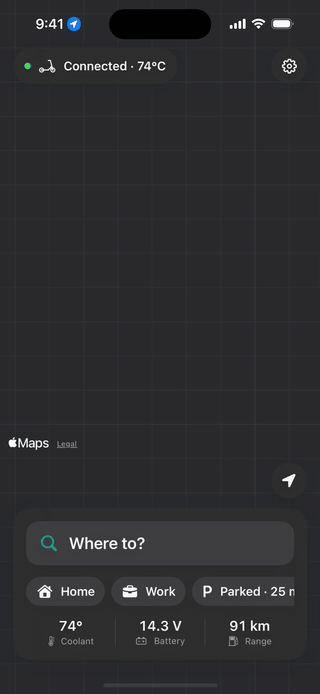
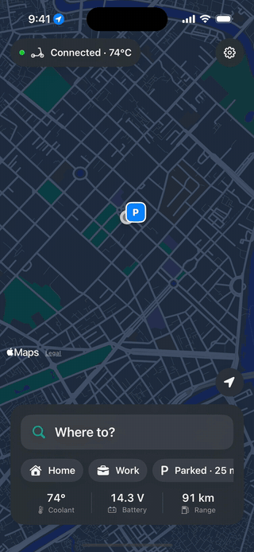

# VesNavi (iOS)

[Tiếng Việt](README.md) · **English**

A **free** iPhone navigation app that shows turn-by-turn directions on the TFT dashboard of the **Vespa GTS Supertech 300 HPE**, replacing the official app's paid navigation. It also shows live engine data, records your rides, tracks fuel and reminds you of service. Vietnamese / English.

**Current version: 1.0.7** — see [CHANGELOG.md](CHANGELOG.md) (in Vietnamese). [](https://ko-fi.com/nxnson)

| Navigation (simulated) | My scooter | Trips | Vietnamese / English |
|:---:|:---:|:---:|:---:|
|  |  |  |  |

<sub>Recorded automatically on the iPhone simulator with simulated scooter data (demo mode) — see [Demo GIFs](#demo-gifs).</sub>

> **Unofficial hobby project.** Not affiliated with or endorsed by Piaggio / Vespa; "Vespa" is a trademark of Piaggio & C. S.p.A. The scooter protocol was worked out from Bluetooth traffic for interoperability and is not guaranteed to work on every scooter. Directions and speed limits are for reference only. Set your destination before riding and don't handle the phone while riding. Use it at your own risk.

## Features

| Area | What it does |
|---|---|
| Navigation | Turn arrow, distance and street name on the TFT; correct roundabout exit; automatic rerouting when off route; ends by itself on arrival; simulation mode to try it standing still |
| Speed limits | OpenStreetMap, OpenStreetMap + Vietnamese default limits (marked "est."), or GraphHopper; red sign in the app when you're over |
| My scooter | RPM, coolant, battery voltage, speed, outside and intake temperature, throttle, fuel rate, odometer; optional coolant/battery line on the TFT; pop-up warnings on the TFT (coolant too hot, battery not charging or low); connects by itself when you start the scooter |
| Trips & fuel | Every ride recorded (distance, time, average/max speed, fuel used, L/100 km, temperatures); fuel left, range and when to refuel; fill-ups detected from the fuel gauge |
| Maintenance | Engine oil, gear oil, air filter, spark plug, brake pads, belt, coolant, brake fluid by km and/or months; overdue items pop up on the TFT once a day |
| Places | Home, Work, favourites, recent destinations; remembers where you parked (with accuracy circle) |
| Language | Vietnamese / English / same as the iPhone — Settings → "Ngôn ngữ / Language", switches instantly |
| Battery | Precise GPS only while navigating; nothing running in the background when idle |

## Compatibility

- **Tested on:** Vespa GTS Supertech 300 HPE (TFT with the "BT ROUTER" Bluetooth module) and iPhone with iOS 17 or later.
- **Other models:** TFT Vespas that use the older PMP3 Bluetooth service (0x1815) are supported in code but untested. Reports and Bluetooth logs are welcome.
- **Outside Vietnam:** set Settings → Speed limit to **OpenStreetMap**, since the "+ VN rules" option estimates limits with Vietnamese law.

## Data sources (all free)

| Part | Source |
|---|---|
| Map + address search | Apple MapKit (built into iOS) |
| Routing | **OSRM** (default, no key) or GraphHopper (free plan ≈500 requests/day, needs a key; falls back to OSRM on errors or when the quota runs out). The free GraphHopper plan only has the *Car* profile, which respects one-way streets and works fine for a scooter. |
| Speed limits | OpenStreetMap through the Overpass API, Vietnamese defaults, or GraphHopper |
| Route following, off-route detection, scooter protocol | Written for this app (`NavCore`) |

## Data attribution

- Routes (OSRM, GraphHopper) and speed limits (Overpass API) use data **© [OpenStreetMap](https://www.openstreetmap.org/copyright) contributors**, licensed under the ODbL. The app credits it on the route screen and in Settings → About.
- Map and search: Apple Maps.
- The public OSRM and Overpass servers are meant for testing and light use. That's fine for personal use; a wider release should self-host or use a paid service.

## Installing on an iPhone (no Mac needed)

The app isn't on the App Store; install it yourself with a free Apple ID.

1. Open **Releases** in this repo → latest version → download **`VespaNav.ipa`**.
2. On a Windows PC, install **iTunes** (the apple.com download, not the Microsoft Store one) and **[Sideloadly](https://sideloadly.io)**. Sideloadly also runs on a Mac.
3. Connect the iPhone → open Sideloadly → drop `VespaNav.ipa` in → enter your Apple ID → **Start**.
4. On the iPhone: **Settings → General → VPN & Device Management** → trust your Apple ID.
5. First time only: turn on **Settings → Privacy & Security → Developer Mode** (iOS 16+); the iPhone restarts.

> ⚠️ With a free Apple ID the app expires after **7 days**. Re-install it with the same `.ipa` in Sideloadly (about a minute; your data stays).

### Without a computer: SideStore

[SideStore](https://sidestore.io) re-signs the app every 7 days on the iPhone itself; a computer is needed once to install it, via [iLoader](https://github.com/nab138/iloader).

1. Install SideStore and **LocalDevVPN** (App Store) following SideStore's guide, and keep LocalDevVPN on.
2. SideStore → **Sources** → **+** → paste: `https://github.com/nxnson-pro/vesnavi/releases/latest/download/apps.json`
3. Open the VesNavi source → **Get**. New versions show up as **Update** in SideStore.
4. Enable background refresh for SideStore (or a daily Shortcuts automation running "Refresh All Apps") so the 7-day limit never hits.

## Connecting the scooter (first time)

1. Turn the key so the dashboard is on.
2. On the dashboard: **Settings → Configuration → Pairing configuration**.
3. On the iPhone: **Settings → Bluetooth** → choose **"BT ROUTER"** (code **0000** if asked).
4. Fully close the official Vespa app (if installed) → in VesNavi tap the scooter badge → **Connect**.

You only pair once; after that VesNavi connects by itself when you start the scooter. For the parking spot to be saved with the phone in your pocket, allow **"Always"** location access. If something goes wrong: **My scooter → Bluetooth Lab → Export log** and attach it to your report.

## Building from source

There's no need for a Mac: GitHub Actions builds everything.

- **Project:** `project.yml` is an [XcodeGen](https://github.com/yonaskolb/XcodeGen) spec. The `.xcodeproj` is generated in CI and not committed. On a Mac: `xcodegen generate`, then open `VespaNav.xcodeproj`.
- **CI** (`.github/workflows/ci.yml`) runs on every push, in this order:
  1. `NavCore` unit tests on Linux.
  2. Unsigned `VespaNav.ipa` build on macOS.
  3. GitHub Release whenever `MARKETING_VERSION` in `project.yml` changes, with the IPA and the SideStore source `apps.json`.
- **Tests:** `swift test --package-path NavCore` (pure Swift, runs on Linux or macOS).

## Demo GIFs

The GIFs at the top are recorded automatically, without a Mac:

- **Tours:** `UITests/TourTests.swift` holds scripted tours through the app, one per GIF.
- **Demo mode:** the app runs with `-demoMode YES` (Debug builds only). It fakes a connected scooter with live engine data, plus ride history, fuel, service items and saved places around District 1, Saigon. The simulator has no Bluetooth, so the real dashboard can't be recorded.
- **Workflow:** **Demo GIFs** (Actions → *Demo GIFs* → *Run workflow*) builds for the simulator and records every tour in Vietnamese and English. It converts the recordings to GIFs and commits them to `docs/media/` and `docs/media/en/`.

## Support

VesNavi is free and complete. If it's useful to you, you can buy the author a coffee — entirely optional:

- [☕ Ko-fi](https://ko-fi.com/nxnson) (card / PayPal)
- Bank transfer in Vietnam (VietQR, Techcombank): see the [QR code](docs/media/vietqr.png)

## License

Source code under the [MIT License](LICENSE). "Vespa" and "Piaggio" are trademarks of Piaggio & C. S.p.A., used only to describe compatibility.

## Project layout

```
NavCore/            Pure Swift package (no UIKit), tested on Linux CI
  Sources/NavCore/  Routing (OSRM/GraphHopper), route following, scooter protocols (PMP3, Cobo/PMP2),
                    engine-data decoding, trips & fuel, speed limits, maintenance, VI/EN text
  Tests/            Unit tests
App/                SwiftUI app: AppModel, VespaBLE (Bluetooth), LocationService, stores, Views/
UITests/            Scripted tours for the demo GIFs (demo mode)
docs/               Protocol notes (pmp3, pmp2-cobo), Bluetooth capture guide, media/ (GIFs)
project.yml         XcodeGen spec
.github/workflows/  CI (tests → IPA → release) and Demo GIFs
```
