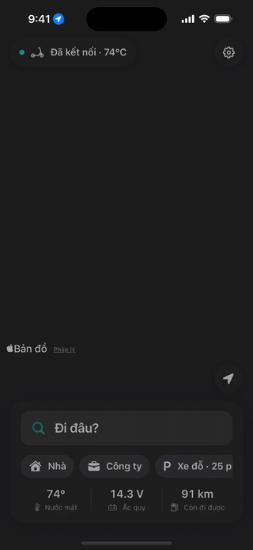
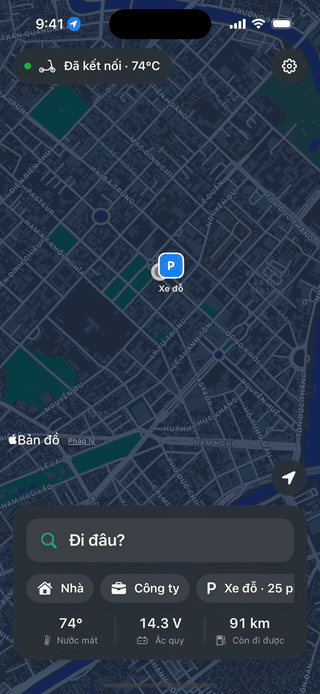

# VesNavi (iOS + Android)

[English](README.md) · **Tiếng Việt**

App dẫn đường **miễn phí**, mã nguồn mở cho **iPhone và Android**, hiển thị hướng rẽ lên màn hình TFT của **Vespa GTS Supertech 300 HPE** — thay cho phần dẫn đường HERE Maps trả phí trong app chính hãng (bản đồ đã cũ). Kèm thông số xe trực tiếp, ghi hành trình, theo dõi xăng và nhắc bảo dưỡng. Tiếng Việt / English.

App được vibe code: một người đi xe làm cùng trợ lý lập trình AI và chạy thử trên chính xe của mình — có thể còn lỗi, rất mong mọi người báo lại.

**Phiên bản hiện tại: 0.1.0 (thử nghiệm)** — xem [CHANGELOG.md](CHANGELOG.md). [](#ủng-hộ)

| Dẫn đường (mô phỏng) | Xe của tôi | Hành trình | Tiếng Việt / English |
|:---:|:---:|:---:|:---:|
|  |  |  |  |

<sub>Quay tự động trên máy ảo iPhone với dữ liệu xe giả lập (chế độ demo) — xem mục [GIF giới thiệu](#gif-giới-thiệu).</sub>

> **Dự án cá nhân, không chính hãng.** VesNavi không liên kết và không được Piaggio / Vespa xác nhận; "Vespa" là nhãn hiệu của Piaggio & C. S.p.A. Giao thức kết nối xe được tìm hiểu từ dữ liệu Bluetooth để tương thích, không đảm bảo hoạt động đúng trên mọi xe. Chỉ đường và giới hạn tốc độ chỉ để tham khảo. Đặt điểm đến trước khi chạy, không thao tác điện thoại khi lái. Bạn tự chịu trách nhiệm khi sử dụng.

## Tính năng

| Nhóm | Nội dung |
|---|---|
| Dẫn đường | Mũi tên + khoảng cách + tên đường trên TFT, vòng xuyến đúng lối ra, tự tìm đường lại khi lệch tuyến, tự kết thúc khi tới nơi, mô phỏng để thử tại chỗ |
| Giới hạn tốc độ | OpenStreetMap + luật VN (TT 38/2024, ghi "ước tính") hoặc GraphHopper |
| Xe của tôi | Vòng tua, nước làm mát, ắc quy, tốc độ, ODO…; popup cảnh báo trên TFT; tự kết nối khi bật xe |
| Hành trình & xăng | Ghi mỗi chuyến, L/100 km, xăng còn lại, quãng đường còn đi được, ngày nên đổ xăng, tự nhận biết đổ xăng |
| Bảo dưỡng | Nhắc theo ODO/tháng, popup trên TFT khi quá hạn |
| Địa điểm | Nhà, Công ty, Yêu thích, Gần đây, nhớ chỗ đỗ xe |
| Ngôn ngữ | Tiếng Việt / English / theo iPhone — Cài đặt → "Ngôn ngữ / Language" |

## Nguồn dữ liệu (tất cả miễn phí)

| Thành phần | Dùng gì |
|---|---|
| Bản đồ + tìm địa chỉ | Apple MapKit (có sẵn trong iOS) |
| Tính đường | **OSRM** (mặc định, không cần key) hoặc GraphHopper (free ~500 lượt/ngày, cần key; lỗi/hết lượt tự quay về OSRM) |
| Giới hạn tốc độ | OpenStreetMap qua Overpass API, luật VN, hoặc GraphHopper |
| Bám tuyến, lệch tuyến, giao thức xe | Tự viết (`NavCore`) |

## Ghi công dữ liệu

- Tuyến đường (OSRM, GraphHopper) và giới hạn tốc độ (Overpass API) dùng dữ liệu **© [OpenStreetMap](https://www.openstreetmap.org/copyright) contributors**, giấy phép ODbL — app ghi công trên màn hình tuyến đường và trong Cài đặt → Thông tin.
- Bản đồ và tìm kiếm: Apple Maps.
- Máy chủ OSRM và Overpass công cộng dành cho dùng thử / lượng nhỏ: hợp với dùng cá nhân; phát hành rộng thì nên tự dựng hoặc dùng dịch vụ trả phí.

## Cài app lên iPhone (không cần Mac)

1. Vào **Releases** của repo → bản mới nhất → tải **`VespaNav.ipa`** (bản build thử nghiệm giữa các phiên bản: tab **Actions** → lần chạy **CI** xanh mới nhất → artifact **VespaNav-ipa**, chỉ giữ 14 ngày).
2. Trên laptop Windows: cài **iTunes** (bản tải từ apple.com, không phải Microsoft Store) và **[Sideloadly](https://sideloadly.io)**.
3. Cắm iPhone vào laptop → mở Sideloadly → kéo `VespaNav.ipa` vào → nhập Apple ID → **Start**.
4. Trên iPhone: **Cài đặt → Cài đặt chung → VPN & Quản lý thiết bị** → tin cậy Apple ID của bạn.
5. Lần đầu: bật **Cài đặt → Quyền riêng tư & Bảo mật → Chế độ nhà phát triển** (iOS 16+), iPhone sẽ khởi động lại.

> ⚠️ Apple ID miễn phí: app hết hạn sau **7 ngày** → mở Sideloadly cài lại bằng cùng file `.ipa` (~1 phút, dữ liệu trong app vẫn giữ).

### Không cần máy tính: SideStore

[SideStore](https://sidestore.io) tự ký lại app mỗi 7 ngày ngay trên iPhone (chỉ cần máy tính một lần lúc cài, qua [iLoader](https://github.com/nab138/iloader)).

1. Cài SideStore và **LocalDevVPN** (App Store) theo hướng dẫn của SideStore; để LocalDevVPN bật.
2. SideStore → **Sources** → **+** → dán: `https://github.com/nxnson-pro/vesnavi/releases/latest/download/apps.json`
3. Mở nguồn VesNavi → **Get**. Bản mới sẽ hiện nút **Update** trong SideStore.
4. Bật làm mới nền cho SideStore (hoặc tạo Phím tắt tự động "Refresh All Apps" hằng ngày) để không bao giờ hết hạn 7 ngày.

## Android (thử nghiệm)

1. Vào **Releases** → bản mới nhất → tải **`VesNavi.apk`** về điện thoại Android (8.0 trở lên).
2. Mở file → cho phép **cài ứng dụng không rõ nguồn** khi được hỏi → Cài đặt.
3. Cho phép quyền **Vị trí**, **Thông báo** và (khi bấm Kết nối xe) **Thiết bị ở gần / Bluetooth**.

- Cùng tính năng với bản iOS; bản đồ **OpenFreeMap** (dữ liệu OpenStreetMap), tìm địa chỉ bằng **Photon** — đều miễn phí, không cần key.
- Khi đang dẫn đường hoặc kết nối xe, app chạy nền với thông báo **"VesNavi"** (bấm **Dừng** để tắt hẳn).
- ⚠️ **Chưa thử trên xe thật.** Xe GTS Supertech (PMP2) cần điện thoại hỗ trợ *phát quảng bá BLE* (đa số máy từ 2018). Không kết nối được: **Xe của tôi → Bluetooth Lab → Xuất log** và gửi cho dev.
- Nếu Release chưa có khoá ký cố định, bản mới phải **gỡ bản cũ rồi cài lại** (mất dữ liệu trong app).

## Kết nối xe lần đầu

1. Bật chìa khoá để màn hình xe sáng.
2. Trên màn hình xe: **Settings → Configuration → Pairing configuration**.
3. Trên điện thoại: **Cài đặt → Bluetooth** → chọn **"BT ROUTER"** (mã **0000** nếu được hỏi).
4. Đóng hẳn app Vespa chính hãng (nếu có) → trong VesNavi chạm biểu tượng xe → **Kết nối**.

Chỉ cần ghép đôi một lần, những lần sau app tự kết nối khi bật xe. Có lỗi: **Xe của tôi → Bluetooth Lab → Báo lỗi lên GitHub** — app mở sẵn form issue kèm log (đã ẩn địa chỉ Bluetooth, khoá ghép đôi, tên thiết bị khác), bạn chỉ cần đăng nhập GitHub và bấm *Submit*. Hoặc mở [form báo lỗi](https://github.com/nxnson-pro/vesnavi/issues/new?template=bug_report.yml) trực tiếp.

## Phát hành phiên bản mới

1. Sửa `MARKETING_VERSION` trong `project.yml` và ghi chú trong `CHANGELOG.md` (tiếng Anh trước, tiếng Việt sau).
2. Push lên GitHub → CI thấy version mới thì tự tạo **Release `vX.Y.Z`** kèm `VespaNav.ipa`, `VesNavi.apk` (Android dùng chung version) và nguồn SideStore `apps.json` (không hết hạn; mỗi version chỉ tạo 1 lần). Số build = số lần chạy CI, hiện ở Cài đặt → Phiên bản, ví dụ `1.0.0 (27)`.

## GIF giới thiệu

Các GIF ở đầu trang được quay tự động, không cần Mac:

- `UITests/TourTests.swift` — kịch bản bấm qua từng màn hình (mỗi test = 1 GIF).
- App chạy **chế độ demo** (`-demoMode YES`, chỉ có trong bản Debug): xe "đã kết nối" với thông số giả lập, lịch sử hành trình, xăng, bảo dưỡng, Nhà/Công ty/chỗ đỗ quanh Quận 1. Máy ảo không có Bluetooth nên không quay được màn hình xe thật.
- Workflow **Demo GIFs** (tab Actions → *Demo GIFs* → *Run workflow*) build app cho máy ảo, quay từng kịch bản bằng tiếng Việt và tiếng Anh, chuyển sang GIF và tự commit vào `docs/media/` (bản tiếng Anh ở `docs/media/en/`, dùng cho [README.md](README.md) tiếng Anh). Chạy lại sau khi đổi giao diện (~10 phút macOS).

## Ủng hộ

VesNavi miễn phí và đầy đủ tính năng. Nếu app có ích, bạn có thể mời tác giả một ly cà phê — hoàn toàn tự nguyện:

- [☕ Ko-fi](https://ko-fi.com/nxnson) (thẻ / PayPal)
- Chuyển khoản VietQR (Techcombank):


## Giấy phép

Mã nguồn theo giấy phép [MIT](LICENSE). "Vespa" và "Piaggio" là nhãn hiệu của Piaggio & C. S.p.A., chỉ dùng để mô tả xe tương thích.

## Cấu trúc

```
NavCore/            Swift package thuần (không UIKit) — test được trên Linux CI
  Sources/NavCore/  Định tuyến (OSRM/GraphHopper), bám tuyến, giao thức xe (PMP3, Cobo/PMP2),
                    giải mã thông số xe, hành trình & xăng, giới hạn tốc độ, bảo dưỡng, văn bản VI/EN
  Tests/            Unit tests
App/                SwiftUI app: AppModel, VespaBLE (Bluetooth), LocationService, các Store, Views/
UITests/            Kịch bản quay GIF giới thiệu (UI test, chế độ demo)
docs/               Ghi chú giao thức (pmp3, pmp2-cobo), hướng dẫn bắt log Bluetooth, media/ (GIF)
project.yml         XcodeGen — .xcodeproj được sinh trong CI, không commit
android/navcore/    Bản Kotlin của NavCore (JVM, cùng bộ test) — ./gradlew :navcore:test -Pvesnavi.coreOnly=true
android/app/        App Android: Jetpack Compose, MapLibre, BLE (central + GATT server), dịch vụ chạy nền
.github/workflows/  CI: test NavCore + navcore Kotlin (Linux) → build .apk + .ipa chưa ký → Release khi đổi version;
                    Demo GIFs: quay máy ảo → docs/media/
```
